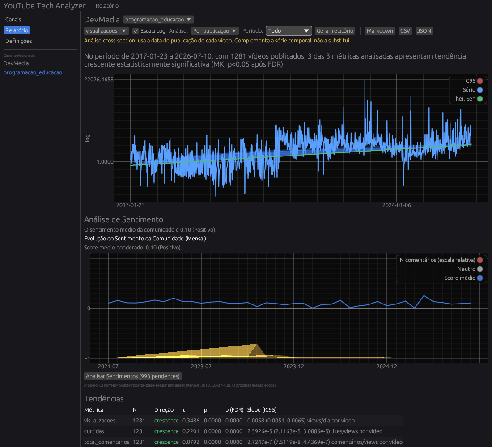
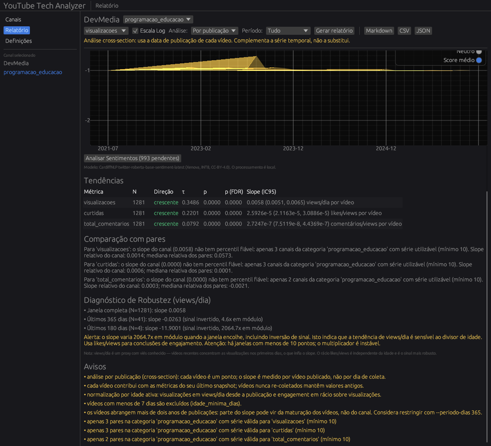

# YouTube Tech Analyzer

[](https://github.com/GustavoGarciaPereira/youtube-tech-analyzer/actions/workflows/ci.yml)
[](LICENSE)
[](https://www.rust-lang.org)

## Screenshot

### Relatório com escala logarítmica

Canal com 1281 vídeos, eixo por data de publicação e rácio de engagement em
escala logarítmica: a linha Theil-Sen deixa de ser esmagada pelos outliers.



### Diagnóstico de robustez estatística

A auto-auditoria mostra que o slope de views/dia varia 2062x (e inverte de
sinal) quando a janela temporal encolhe.



Pipeline de ETL e análise de canais de tecnologia do YouTube, escrito em Rust.

O projeto recolhe metadados de canais, vídeos e comentários, guarda snapshots
históricos numa base de dados SQLite e gera relatórios estatísticos sobre a
evolução de métricas como visualizações, curtidas e número de comentários.
Inclui uma GUI desktop em `egui` e uma CLI (`yta`).

> **Estado:** MVP funcional. Coleta, relatórios, GUI e CLI estão implementados.

---

## Funcionalidades

- Resolução de canais por URL, `@handle` ou channel ID.
- Snapshots diários de métricas de canal e de vídeo.
- Recolha de comentários e respostas, com profundidade configurável.
- Classificação manual de canais em quatro categorias.
- Relatórios com:
  - Mann-Kendall para direção e significância;
  - Theil-Sen para declive e intervalo de confiança;
  - correção de comparações múltiplas Benjamini-Hochberg (FDR);
  - comparação com canais pares da mesma categoria;
  - exportação Markdown, CSV e JSON.
- GUI com três ecrãs: Canais, Relatório e Definições.
- CLI pensada para automação e uso avançado.
- Coleta idempotente:
  - comentários são recolhidos uma vez por vídeo;
  - métricas são gravadas diariamente;
  - `--recoletar-comentarios` força um refresh manual.
- Base de dados local; não há telemetria nem servidor próprio.

---

## Arquitetura

Workspace Cargo com separação Clean/Hexagonal. As dependências apontam para
dentro, em direção ao domínio.

| Crate | Responsabilidade |
|---|---|
| `domain` | Entidades, value objects e portas. Sem IO, rede ou SQLite. |
| `application` | Casos de uso de coleta e geração de relatórios. |
| `analysis` | Mann-Kendall, Theil-Sen e Benjamini-Hochberg. |
| `infra-youtube` | Adaptador da YouTube Data API v3. |
| `infra-storage` | Repositório SQLite, migrações e cache de classificações. |
| `infra-ai` | Classificação por LLM via OpenCode (experimental). |
| `desktop` | Composition root, GUI `egui` e binário CLI `yta`. |

Fluxo principal:

```text
YouTube Data API v3
        │
        ▼
infra-youtube ──► application/ColetarCanal ──► infra-storage/SQLite
                                                     │
                                                     ▼
                                        application/GerarRelatorio
                                                     │
                                      ┌──────────────┴──────────────┐
                                      ▼                             ▼
                                  GUI desktop                     CLI `yta`
```

O crate `domain` não depende de `reqwest`, `rusqlite`, `egui` nem `tokio`.
A camada `application` não depende de `infra-*` nem de `desktop`.

---

## Requisitos

- Rust stable com edition 2024 (1.85+). O `rust-toolchain.toml` usa o canal
  `stable`; se o teu toolchain estiver desatualizado, corre `rustup update`
  antes de compilar.
- Uma chave da **YouTube Data API v3** para adicionar e coletar canais.
- Linux com X11 ou Wayland e drivers OpenGL para a GUI.
  A CLI funciona sem ambiente gráfico.
- SQLite não precisa de ser instalado: `rusqlite` usa a feature `bundled`.
- Opcional: CLI `opencode` e `OPENCODE_MODEL` para a classificação LLM
  experimental.

> A API do YouTube tem quota. Uma coleta grande, especialmente com
> `--max-depth -1`, pode consumir quota rapidamente.

---

## Configuração

Clona o repositório:

```bash
git clone https://github.com/GustavoGarciaPereira/youtube-tech-analyzer.git
cd youtube-tech-analyzer
```

Copia o exemplo e preenche o `.env` na raiz do projeto:

```bash
cp .env.example .env
```

```dotenv
YOUTUBE_API_KEY=a-tua-chave-da-youtube-data-api-v3
```

O `.env.example` não contém segredos. O `.env` é carregado automaticamente
por `dotenvy`. Variáveis já exportadas na shell têm prioridade. O `.env` está
no `.gitignore`; nunca faças commit da chave.

Variáveis opcionais:

| Variável | Efeito |
|---|---|
| `YTA_DB_PATH` | Caminho alternativo para a base de dados SQLite. |
| `OPENCODE_BIN` | Binário do OpenCode usado por `infra-ai` (default: `opencode`). |
| `OPENCODE_MODEL` | Modelo exigido pelo exemplo de classificação LLM. |

Caminho por omissão da base de dados:

```text
~/.local/share/yta/yta.db
```

Em sistemas com `XDG_DATA_HOME`, é usado `$XDG_DATA_HOME/yta/yta.db`.

---

## Instalação

Binários Linux x86_64 (glibc >= 2.35) estão na
[página de releases](https://github.com/GustavoGarciaPereira/youtube-tech-analyzer/releases).
O arquivo inclui `yta` (CLI), `yta-desktop` (GUI) e `INSTALL.txt`.

```bash
sha256sum -c yta-v0.1.0-x86_64-unknown-linux-gnu.tar.gz.sha256
tar -xzf yta-v0.1.0-x86_64-unknown-linux-gnu.tar.gz
cd yta-v0.1.0-x86_64-unknown-linux-gnu
./yta --help
./yta-desktop   # GUI: precisa de libxkbcommon, libwayland e libGL
```

Em Debian/Ubuntu, as bibliotecas da GUI instalam-se com:

```bash
sudo apt install libxkbcommon0 libwayland-client0 libx11-6 libgl1
```

Para compilar do código-fonte, ver a secção seguinte.

---

## Compilar

```bash
cargo build --workspace
```

O crate `desktop` tem dois binários:

- `desktop`: GUI;
- `yta`: CLI.

Como o crate tem múltiplos binários, é obrigatório indicar `--bin`.

---

## GUI

```bash
cargo run -p desktop --bin desktop
```

Depois de compilada:

```bash
./target/debug/desktop
```

Versão otimizada:

```bash
cargo run -p desktop --bin desktop --release
```

A GUI arranca mesmo sem `YOUTUBE_API_KEY`. As operações de rede
(adicionar/coletar) mostram um erro nesse caso; listar canais e gerar
relatórios continuam disponíveis.

### Ecrãs

- **Canais**
  - Lista de canais com categoria, inscritos e total de vídeos.
  - Adicionar canal por URL, `@handle` ou ID.
  - Alterar categoria manual.
  - Coletar um canal ou todos os canais.
  - Progresso em tempo real, com cancelamento.

- **Relatório**
  - Métrica: visualizações, curtidas ou total de comentários.
  - Período: 30, 60, 90 dias ou tudo.
  - Gráfico de série temporal, linha Theil-Sen e banda IC95.
  - Tabela de tendências, comparação com pares e avisos.
  - Exportação Markdown/CSV/JSON copiada para o clipboard.
  - `Ctrl+R` regenera o relatório.

- **Definições**
  - Caminho da base de dados, versão, commit e schema.
  - Abrir a pasta da base de dados.
  - Formato de exportação e período por omissão.

As preferências ficam em:

```text
~/.config/yta/prefs.toml
```

ou em `$XDG_CONFIG_HOME/yta/prefs.toml`.

---

## CLI

```bash
cargo run -p desktop --bin yta -- --help
```

Depois de compilada:

```bash
./target/debug/yta --help
```

### Comandos

| Comando | Descrição |
|---|---|
| `yta canal adicionar <REF>` | Resolve um canal e guarda os metadados. |
| `yta canal listar` | Lista os canais guardados. |
| `yta canal categorizar <REF> --categoria <CAT>` | Define a categoria manual. |
| `yta canal coletar <REF>` | Coleta vídeos, métricas e comentários. |
| `yta canais coletar-todos` | Coleta todos os canais guardados. |
| `yta relatorio <REF>` | Gera um relatório do canal. |
| `yta db caminho` | Mostra o caminho da base de dados em uso. |

`<REF>` pode ser um channel ID (`UC...`), um `@handle` ou uma URL do YouTube.

### Categorias manuais

Valores aceites:

- `programacao`
- `programacao_educacao`
- `tecnologia`
- `outro`

A categoria manual é usada como baseline de comparação de pares. É
independente de qualquer classificação automática por LLM.

### Exemplos

```bash
# Adicionar um canal
./target/debug/yta canal adicionar "https://www.youtube.com/@handle"

# Listar canais e categorizar
./target/debug/yta canal listar
./target/debug/yta canal categorizar UCxxxxxxxxxxxxxxxxxxxxxx --categoria programacao

# Coletar os 20 vídeos mais recentes
./target/debug/yta canal coletar UCxxxxxxxxxxxxxxxxxxxxxx --max-videos 20

# Coletar todas as respostas de comentários (consome muita quota)
./target/debug/yta canal coletar UCxxxxxxxxxxxxxxxxxxxxxx --max-depth -1

# Forçar refresh dos comentários já recolhidos
./target/debug/yta canal coletar UCxxxxxxxxxxxxxxxxxxxxxx --recoletar-comentarios

# Coletar todos os canais
./target/debug/yta canais coletar-todos

# Relatório em Markdown
./target/debug/yta relatorio UCxxxxxxxxxxxxxxxxxxxxxx --formato md

# Relatório dos últimos 90 dias, em JSON
./target/debug/yta relatorio UCxxxxxxxxxxxxxxxxxxxxxx \
  --formato json --periodo-dias 90 --saida relatorio.json

# Caminho da base de dados
./target/debug/yta db caminho
```

`--max-depth` controla a profundidade de respostas a comentários. O valor por
omissão é `2`; `-1` recolhe todas as respostas e deve ser usado com cuidado.
`--max-depth -1` pode multiplicar o consumo de quota por 10–20× num canal com
muitos comentários. Para uma coleta de rotina, mantém o default `2`.

### Formato dos relatórios

- `md`: relatório legível, com sumário, tabela de tendências, comparação com
  pares, avisos e limitações.
- `csv`: cabeçalho fixo e uma linha por métrica.
- `json`: relatório completo, incluindo a série usada no gráfico.

Sem `--saida`, o relatório é escrito em `stdout`.

---

## Coleta e idempotência

A coleta foi desenhada para poder correr repetidamente sem duplicar dados.

- `canais`, `videos` e `comentarios` usam upsert por `id`.
- Cada snapshot é único por `(entidade_tipo, entidade_id, metrica, data_coleta)`.
- `data_coleta` usa `YYYY-MM-DD` em UTC.
- Os comentários têm um marcador one-time por vídeo:
  - a primeira coleta busca comentários;
  - as seguintes não voltam a buscá-los;
  - `--recoletar-comentarios` ignora o marcador.
- As métricas de visualizações, curtidas e total de comentários são gravadas
  diariamente. Uma coleta num novo dia acrescenta uma nova observação à série.

Para haver tendências, é necessário coletar em dias diferentes. O projeto
**não inclui** cron/systemd; a automatização diária fica para uma fase
posterior.

---

## Relatórios

Por omissão, o relatório analisa:

- `visualizacoes`
- `curtidas`
- `total_comentarios`

Cada métrica precisa de pelo menos **5 snapshots** para entrar na análise.
Abaixo de **20 snapshots**, o relatório continua a ser gerado, mas marca a
amostra como insuficiente para inferência preditiva.

A comparação de pares usa a categoria manual do canal. Se não existirem pares
na mesma categoria, o relatório faz fallback para todos os canais e emite um
aviso.

O nível de significância por omissão é `0.05`, com correção FDR sobre as
métricas do relatório.

---

## Base de dados

Tabelas principais:

- `canais`
- `videos`
- `comentarios`
- `snapshots`
- `canal_categoria_manual`
- `classificacoes_nicho` (canónica)
- `classificacoes_nicho_cache` (cache do LLM)

A versão atual do schema é `3`.

Para inspecionar a base de dados:

```bash
sqlite3 "$(./target/debug/yta db caminho)"
```

O projeto não usa `INSERT OR REPLACE` em tabelas com `ON DELETE CASCADE`;
usa upserts com `ON CONFLICT` para preservar registos dependentes.

---

## Testes e qualidade

```bash
cargo fmt --all -- --check
cargo clippy --workspace --all-targets -- -D warnings
cargo test --workspace
cargo build --workspace
```

A suite cobre domínio, casos de uso, adaptadores, CLI e funções puras da GUI.

---

## Estrutura do repositório

```text
.
├── .env.example
├── .github/workflows/ci.yml
├── CONTRIBUTING.md
├── LICENSE
├── README.md
├── Cargo.toml
├── rust-toolchain.toml
├── docs/
├── crates/
│   ├── domain/
│   ├── application/
│   ├── analysis/
│   ├── infra-youtube/
│   ├── infra-storage/
│   ├── infra-ai/
│   └── desktop/
│       ├── src/main.rs      # GUI
│       ├── src/app.rs
│       ├── src/state.rs
│       ├── src/prefs.rs
│       ├── src/wiring.rs
│       └── src/bin/yta.rs   # CLI
└── ...
```

---

## Classificação por LLM (experimental)

O crate `infra-ai` contém um adaptador para classificação de nicho via
OpenCode. Ainda **não está integrado** no fluxo principal da GUI/CLI.

Exemplo manual:

```bash
export OPENCODE_MODEL=nome-do-modelo
cargo run -p infra-ai --example classificar_manual -- \
  --canal @handle --max-videos 3
```

Requer também `YOUTUBE_API_KEY` e o binário `opencode` disponível no `PATH`
(ou `OPENCODE_BIN`).

---

## Limitações e próximos passos

- Não há agendador diário incluído (cron/systemd).
- Não há cache HTTP das respostas do YouTube.
- A classificação por LLM está experimental e fora do fluxo principal.
- A GUI exporta para o clipboard; ainda não abre um diálogo de ficheiro.
- A remoção de canais está desativada no MVP.
- Relatórios com poucos snapshots produzem avisos, não tendências.
- Próximos passos naturais:
  - automação diária com systemd timer ou cron;
  - integração da classificação por LLM no pipeline;
  - screenshots e documentação visual da GUI.

---

## Contribuições

Lê [CONTRIBUTING.md](CONTRIBUTING.md) antes de abrir um PR. O guia cobre o
ambiente, as verificações obrigatórias, as regras de arquitetura e a
idempotência da coleta.

---

## Licença

MIT — ver [LICENSE](LICENSE).
